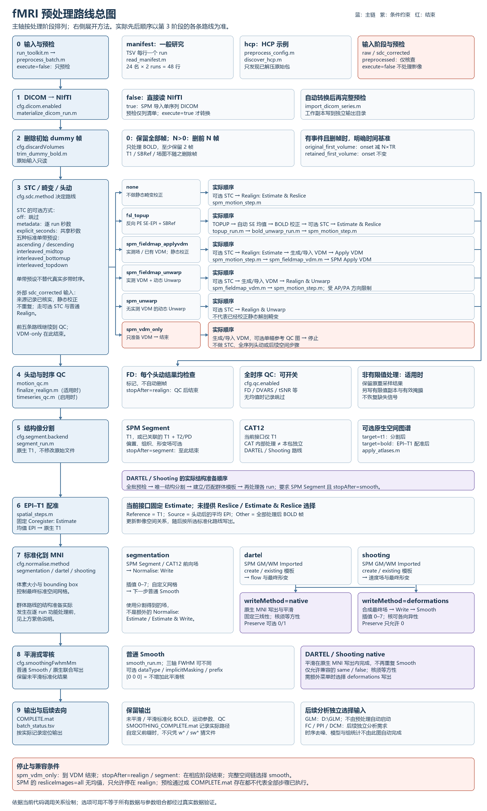
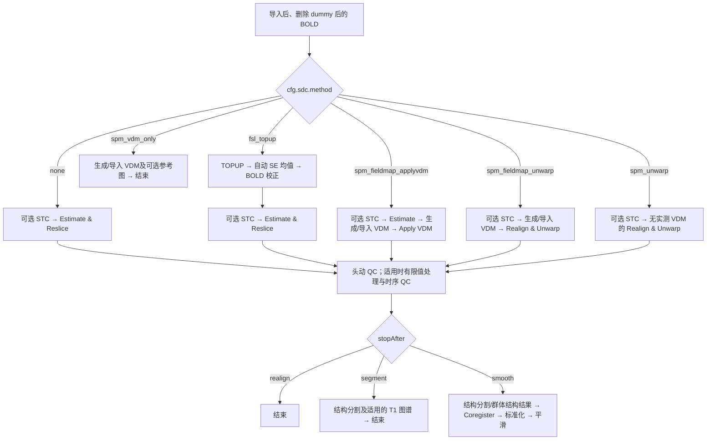
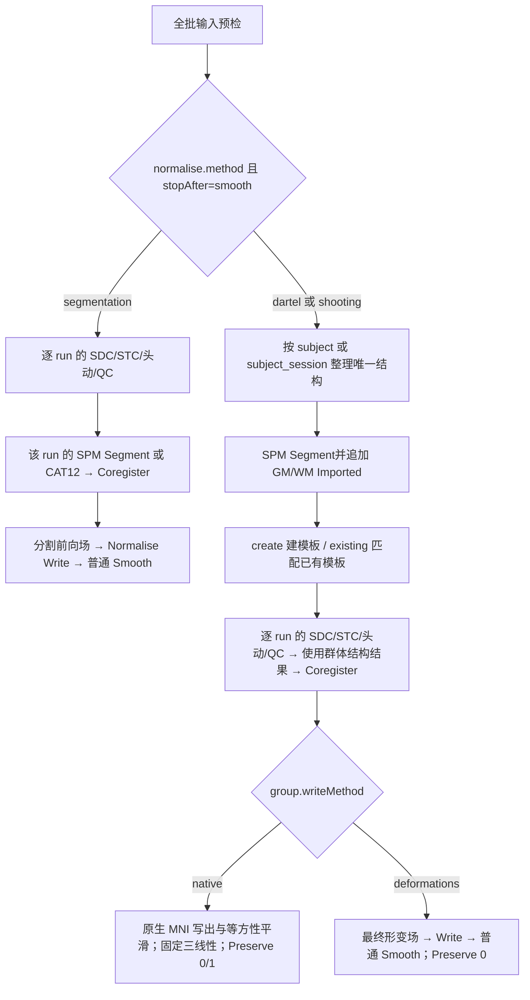

# 预处理路线总图

图的主轴按处理阶段排列，右侧展开方法及其去向。**STC、畸变校正与头动没有一个适用于所有分支的统一先后顺序**；第 3 阶段逐条给出当前代码的实际顺序。

[打开可放大的矢量图](figures/preprocessing_routes.svg)。图中可选步骤不代表每次都执行；以配置、逐 run 输入和完成记录为准。

## 1. 读图时先确认四件事

| 确认项 | 对后续流程的影响 |
|---|---|
| `execute` 与 `inputStage` | false 只预检；preprocessed 仅核查；sdc_corrected 必须有来源记录并跳过重复静态校正 |
| `cfg.sdc.method` | 决定 STC、静态场、头动和 Unwarp 的执行顺序；VDM-only 提前结束 |
| `stopAfter` | realign 到头动/QC；segment 到结构分割；smooth 才继续到标准化和平滑 |
| `normalise.method` 与 `group.writeMethod` | 决定群体结构准备、最终写出方式、平滑菜单和输出路径；native 的平滑已合并在原生写出内 |

HCP 入口会由 `preprocess_config.m` 覆盖部分通用配置，见 [总使用指南](PREPROCESSING.md)。本图不把示例数据结构作为一般研究的要求。

## 2. 对应的配置与代码

下表是阅读和定位代码的索引，**不是需要依次手动运行的脚本清单**。一般研究填写配置和清单后运行 `run_toolkit.m`。

| 阶段 | 选择位置 | 主要调用代码 |
|---|---|---|
| 输入与预检 | `inputMode`、清单、逐 run JSON | `preprocess_batch.m`、`read_manifest.m` / `discover_hcp.m`、`inspect_run.m`、`preprocess_plan.m` |
| DICOM 转换 | `dicom.enabled` | `materialize_dicom_run.m`、`import_dicom_series.m` |
| dummy 删除与事件对齐 | `discardVolumes`、`dummy.eventReference`；TSV 可覆盖 | `dummy_plan.m`、`trim_dummy_bold.m`、`write_dummy_events.m` |
| STC | `sliceTiming.*` | `slice_timing_plan.m`；`process_run.m` 调用 SPM Slice Timing |
| SDC 与头动路线 | `sdc.method`、`sdc.*`、`realign.*`、`unwarp.*` | `preprocess_plan.m`、`process_run.m`、`spm_motion_step.m` |
| TOPUP → BOLD | `sdc.*` 的 FSL 设置 | `topup_run.m`（含自动 SE 均值）、`topup_qc.m`、`bold_unwarp_run.m` |
| SPM 场图与 VDM | SPM SDC 参数、场图 JSON | `prepare_spm_sdc.m`、`spm_fieldmap_vdm.m`、`fieldmap_reference.m` |
| 头动/时序 QC | `fdRadiusMm`、`fdFlagMm`、`qc.*` | `motion_qc.m`、`finalize_realign.m`、`timeseries_qc.m` |
| 分割和可选图谱 | `segment.*`、`atlas.*` | `segment_run.m`、`cat12_segment.m`、`apply_atlases.m` |
| EPI–T1 配准 | `coreg.*` | `spatial_steps.m`，固定调用 SPM Coregister: Estimate |
| 普通标准化 | `normalise.method='segmentation'`、输出网格 | `spatial_steps.m`，使用分割场调用 Normalise: Write |
| DARTEL/Shooting | `normalise.method`、`normalise.group.*` 及算法参数 | `preprocess_group_batch.m`、`normalise_group_run.m`、`group_normalise_write.m` |
| 普通/原生平滑 | `smoothingFwhmMm`、`smooth.*`、`group.writeMethod` | `smooth_run.m` 或 `group_normalise_write.m` 内的原生写出 |

计算实现位于 `matlab/+psy/`。例如 `psy.topup_run(...)` 调用的是 `matlab/+psy/topup_run.m`；常规使用无需逐个修改这些函数。

## 3. 六条 SDC 路线的可编辑流程

下面的 Mermaid 文本是与总图一致的可编辑表示；支持 Mermaid 的 Markdown 阅读器可直接渲染。

这几种 SPM 头动操作由路线选择，不要求用户删减代码。静态 Apply VDM 不等于动态 Unwarp；无实测 VDM 的 Unwarp 也不表示已经完成静态解剖畸变校正。SPM `resliceImages='all'` 没有均值图，只允许停在 realign，并记录时序 QC 跳过。详细输入限制见 [SDC](SDC.md)。

## 4. 群体标准化的实际先后顺序

总图按预处理阶段索引展示；DARTEL/Shooting 的群体准备不能机械地理解为“每个 run 完成头动后才开始建模板”。实际调用为：

独立 DARTEL/Shooting 要求 `segment.backend='spm'`；CAT12 内部使用的算法不等于这两条独立路线。`native` 平滑不再额外调用普通 Smooth，且不支持普通 Smooth 的全部菜单；需要各向异性核或额外类型/掩模选项时，选择兼容的 `deformations` 写出。具体约束见 [标准化](Normalization.md) 与 [平滑](<Spatial Smoothing.md>)。

## 5. 结果怎样指向后续分析

| 当前输出/选择 | 后续需要注意 |
|---|---|
| VDM-only 或 stopAfter=realign/segment | 不能当作已经完成标准化和平滑的影像 |
| 未平滑与平滑标准化 BOLD | 后续分析按自己的模型选一种输入；不是把两个版本当作两个 run |
| native / deformations、自定义平滑前缀 | 以 `SMOOTHING_COMPLETE.mat` 等记录定位实际结果，不固定猜测 sw* |
| 改变 SDC、分割、标准化或平滑参数 | 使用新输出目录；旧结果与模型不能不经核对直接混用 |
| GLM | 独立目录为 `D:\GLM`，预处理入口不会自动启动 GLM |
| FC / PPI / DCM | 属于后续独立分析需求；此图不表示这些模块已完整实现，也不替代时序去噪或模型设计 |

图依据当前可调用接口绘制；方法可选与代码可运行，不等于所有参数组合或真实影像质量都已验证。
